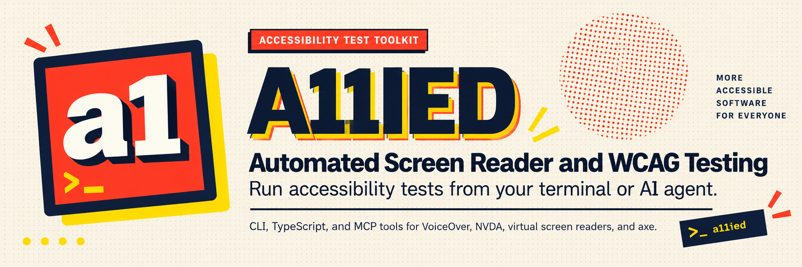

`a11ied` is a CLI-first accessibility toolkit. The [docs site](https://hypothesi.github.io/a11ied/) has the guides and reference, starting with the [quickstart](https://hypothesi.github.io/a11ied/quickstart/). It does three jobs:

- **Look things up**: [WCAG criteria, techniques](https://hypothesi.github.io/a11ied/reference/wcag-data/), [test methods](https://hypothesi.github.io/a11ied/test-methods/), and ARIA patterns, pinned from the W3C sources.
- **Check while you build**: [axe scans](https://hypothesi.github.io/a11ied/guides/violations/), the accessibility tree, screenshots at a viewport or focus stop, [real screen reader sessions](https://hypothesi.github.io/a11ied/guides/screen-reader/) with VoiceOver and NVDA through Guidepup, and TalkBack on Android over adb.
- **Audit**: run an [agent-driven WCAG audit](https://hypothesi.github.io/a11ied/guides/audit/) of a site, page, feature, or mobile app, with durable progress, parallel workers, a live dashboard, and a client-ready report.

## try it in the browser

- [Playground](https://hypothesi.github.io/a11ied/playground/): run the simulated screen reader on a test case or a practice page in your browser, and read the log of what it announced.
- [Screen reader compatibility](https://hypothesi.github.io/a11ied/compatibility/): a "Can I use" for screen readers. Search an ARIA role, attribute, or HTML element to see what each screen reader announces for it, by browser and operating system, from a11ied's recorded runs and W3C ARIA-AT reports. `@a11ied/compat` checks the same data from code.

## install

```sh
npx a11ied setup
```

Setup offers to install the `a1` command globally (it is also available as `a11ied`), to add the a11ied skills and MCP server to your AI coding agents, and to set up VoiceOver or NVDA. To use a11ied as a library or in tests, run `npm install a11ied` in your project.

```sh
a1 doctor                    # check this machine and list the setup steps still needed
a1 setup                     # connect AI agents, set up VoiceOver or NVDA, then re-check
a1 update                    # install the latest version
a1 wcag 4.1.3                # one criterion: techniques, failures, test method, next command
a1 wcag rule color-contrast  # an axe rule mapped back to its criteria and fixes
a1 pattern combobox          # the ARIA pattern: its keyboard and attribute tables
a1 check http://localhost:3000  # scan one page while you build
a1 help-all
```

The [CLI reference](https://hypothesi.github.io/a11ied/reference/cli/) describes every command. [Set up VoiceOver or NVDA](https://hypothesi.github.io/a11ied/screen-readers/#setup) explains what `a1 setup` and `a1 doctor` do on each platform.

## audit a site, page, or app

```sh
a1 audit init https://example.com --rule "Do not submit the contact form"
a1 audit discover            # add the site's pages to the audit
a1 audit scan                # automated checks on every page, in parallel
a1 audit next --worker w1    # each parallel agent claims a unit, tests it, and submits
a1 audit status              # progress at any time; a1 audit dashboard serves a live page
a1 audit report              # HTML, Markdown, and JSON
```

An audit is a set of pages (pages, screens, states, flows) and the success criteria in
scope. The work is split into units, one test pass on one page, that agents claim and
test in parallel. Automated checks record the failures a scanner is certain of and collect
facts for the agents. An agent decides every pass and every not-applicable. State lives in
`.a11ied/audits/<id>/`, so an audit survives a crashed agent or a restart.

Narrow the scope with `--page` (one page), `--criteria 1.4.3,2.4.7`, `--passes keyboard`,
or `--platform ios`. On web, the scan lists the controls on each page that open a menu,
dialog, tab, or section, and a submission must account for every one. A finding gives a
selector for the failing element, and `a1` takes an outlined screenshot of it for the
report. The [audit guide](https://hypothesi.github.io/a11ied/guides/audit/) covers the workflow,
and [internal-docs/audit-architecture.md](internal-docs/audit-architecture.md)
explains the design. Agents use the `a11ied-audit` skill in [`packages/skills/`](packages/skills);
[Set up an AI agent](https://hypothesi.github.io/a11ied/guides/agents/) covers the skills and the [MCP tools](https://hypothesi.github.io/a11ied/reference/mcp/).

Use the [runtime API](https://hypothesi.github.io/a11ied/reference/api/):

```js
import { listWcagCriteria, runAxe, startDriverSession } from 'a11ied';
```

Drive a screen reader from a test ([Write screen reader tests](https://hypothesi.github.io/a11ied/guides/testing/), [Test with Vitest](https://hypothesi.github.io/a11ied/guides/vitest/)). `a11ied/test` works under any runner, and `a11ied/vitest`
adds `toHaveSpoken`, `toHaveSpokenInOrder`, and `toHaveCursorOn` matchers plus a `test`
whose `sr` fixture is a queued screen reader, so a test writes no `await` until it needs a
value. Commands and checks chain, and a check waits up to five seconds for its phrase:

```js
import { queuedScreenReader } from 'a11ied/test';

await using sr = await queuedScreenReader({ url: 'http://localhost:3000/checkout' });

sr.goTo({ role: 'button', name: 'Pay' })
   .press('Enter')
   .expect.spoken('dialog, Confirm payment')
   .and.cursorOn({ role: 'button', name: 'Confirm' });
```

## workspaces

The repo is split into npm workspaces. Three of them are packages people install: `a11ied` from `packages/cli`, `@a11ied/compat` (the [compatibility API](https://hypothesi.github.io/a11ied/guides/compatibility-api/)), and `@a11ied/support-data` (the data behind the [compatibility tables](https://hypothesi.github.io/a11ied/compatibility/)). The other `@a11ied/*` packages are internal. They are published only because `a11ied` depends on them, and their APIs can change in any release.

- [`packages/contracts`](packages/contracts): shared schemas and result shapes (`@a11ied/contracts`)
- [`packages/audit`](packages/audit): audit storage, work units, findings, progress, dashboard, and reports (`@a11ied/audit`)
- [`packages/core`](packages/core): browser, axe, screen reader driver, audit scans, and page checks (`@a11ied/core`)
- [`packages/guidepup`](packages/guidepup): adapter layer for real and virtual screen reader automation (`@a11ied/guidepup`)
- [`packages/mcp-server`](packages/mcp-server): MCP bridge around the core runtime (`@a11ied/mcp-server`)
- [`packages/wcag-data`](packages/wcag-data): normalized WCAG data artifacts (`@a11ied/wcag-data`)
- [`packages/wcag-engine`](packages/wcag-engine): lookup and search APIs over the WCAG data package (`@a11ied/wcag-engine`)
- [`packages/earl`](packages/earl): builds W3C EARL 1.0 accessibility reports as JSON-LD (`@a11ied/earl`)
- [`packages/cli`](packages/cli): end-user command line entrypoint (published as `a11ied`)
- [`packages/compat`](packages/compat): screen reader compatibility checks for editors, linters, and bundlers (`@a11ied/compat`)
- [`packages/support-data`](packages/support-data): the recorded screen reader test cases and results `@a11ied/compat` reads (`@a11ied/support-data`)
- [`packages/act-conformance`](packages/act-conformance): runs a11ied against the W3C ACT test cases (not published)
- [`packages/docs`](packages/docs): Astro docs site (not published)
- [`packages/knowledge`](packages/knowledge), [`packages/observe`](packages/observe): page signal extraction and page measurements used by scans
- [`packages/skills`](packages/skills): the `a11ied` (development checks) and `a11ied-audit` (audits) Agent Skills

## quick start

```sh
npm install
npm run standards
npm test
```

## standards data workflow

See [maintaining the WCAG data](internal-docs/maintaining-wcag-data.md) for what the
data files hold. When you need to refresh the pinned WCAG artifacts, stay at the repo root
and run:

```sh
npm run wcag:sync
npm run wcag:validate
npm run standards
npm test
```

That flow does four things:

- pulls the approved upstream WCAG, ACT, Quickref, WCAG2Mobile, and ARIA Authoring Practices Guide sources into `packages/wcag-data/data/raw/` and the generated artifacts
- regenerates the committed normalized artifacts in `packages/wcag-data/data/generated/`
- checks that lint, typecheck, and builds still pass across the repo
- runs the full Vitest suite through the dedicated `npm test` entrypoint

If the generated diffs look wrong, stop there. The provenance manifests and regression fixtures are supposed to make surprising changes obvious.

For the package-level details, see [packages/wcag-data/README.md](packages/wcag-data/README.md).

## releases

Every published package shares one version, and [Changesets](https://changesets.dev)
writes the changelogs. When a pull request changes what users of `a11ied`,
`@a11ied/compat`, or `@a11ied/support-data` get, run `npx changeset` and describe the
change for them. [.changeset/README.md](.changeset/README.md) says how to write one, and
[the release checklist](internal-docs/maintainer-release-checklist.md) covers publishing.
