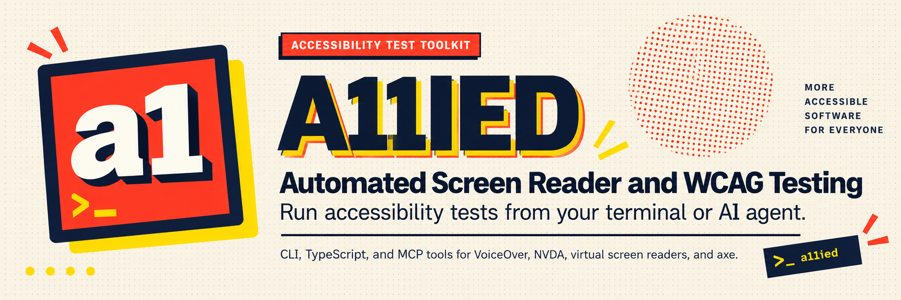

`a11ied` is a CLI-first accessibility toolkit. It runs real screen readers, scans pages, looks up WCAG, and runs WCAG audits with AI agents, from the terminal, from tests, or through an MCP server.

**[Docs](https://hypothesi.github.io/a11ied/)** · [Quickstart](https://hypothesi.github.io/a11ied/quickstart/) · [Playground](https://hypothesi.github.io/a11ied/playground/) · [Screen reader compatibility](https://hypothesi.github.io/a11ied/compatibility/) · [CLI reference](https://hypothesi.github.io/a11ied/reference/cli/) · [Changelog](https://github.com/hypothesi/a11ied/blob/master/packages/cli/CHANGELOG.md)

It does three jobs:

- **Look things up**: [WCAG criteria, techniques](https://hypothesi.github.io/a11ied/reference/wcag-data/), [test methods](https://hypothesi.github.io/a11ied/test-methods/), axe rules, and ARIA patterns, pinned from the W3C sources and shipped with the package, so lookups work offline.
- **Check while you build**: [axe scans](https://hypothesi.github.io/a11ied/guides/violations/), the accessibility tree, screenshots at a viewport, zoom level, or focus stop, [real screen reader sessions](https://hypothesi.github.io/a11ied/guides/screen-reader/) with VoiceOver and NVDA through Guidepup, and TalkBack on Android over adb.
- **Audit**: run an [agent-driven WCAG audit](https://hypothesi.github.io/a11ied/guides/audit/) of a site, page, feature, or mobile app, with durable progress, parallel workers, a live dashboard, and a client-ready report.

## try it in the browser

- [Playground](https://hypothesi.github.io/a11ied/playground/): run the simulated screen reader on a test case or a practice page in your browser, and read the log of what it announced.
- [Screen reader compatibility](https://hypothesi.github.io/a11ied/compatibility/): a "Can I use" for screen readers. Search an ARIA role, attribute, or HTML element to see what each screen reader announces for it, by browser and operating system, from a11ied's recorded runs and W3C ARIA-AT reports. [`@a11ied/compat`](https://www.npmjs.com/package/@a11ied/compat) checks the same data from code.

## install

```sh
npm install a11ied
```

This installs the `a1` command (also available as `a11ied`). It needs Node.js 24 or later.

```sh
a1 doctor     # check this machine and list the setup steps still needed
a1 setup      # run the Guidepup setup steps for VoiceOver or NVDA, then re-check
a1 help-all   # every command and option in one listing
```

[Set up VoiceOver or NVDA](https://hypothesi.github.io/a11ied/screen-readers/#setup) explains what `a1 setup` and `a1 doctor` do on each platform.

## look things up

```sh
a1 wcag 4.1.3                 # one criterion: techniques, failures, test method, next command
a1 wcag rule color-contrast   # an axe rule mapped back to its criteria and fixes
a1 pattern combobox           # the ARIA pattern: its keyboard and attribute tables
a1 search "focus visible"     # WCAG and ARIA Authoring Practices, ranked in one list
```

## check while you build

```sh
a1 check http://localhost:3000            # axe, the accessibility tree, and the criteria that apply
a1 axe http://localhost:3000 --level AA   # axe-core, filtered by WCAG level, criterion, or rule
a1 tree http://localhost:3000             # the accessibility tree
a1 capture http://localhost:3000 --viewport 320x640 --press "Tab*3"   # a PNG and the focused element
```

[Fix scan failures](https://hypothesi.github.io/a11ied/guides/violations/) walks through reading the results.

## drive a screen reader

```sh
a1 sr start http://localhost:3000 --sr voiceover   # or nvda on Windows, or virtual anywhere
a1 sr next heading                                 # move by item, heading, landmark, form field, ...
a1 sr activate                                     # press the current control
a1 sr expect "dialog, Confirm payment"             # fail when the reader did not say it
a1 sr transcript                                   # everything the reader said, with timestamps
a1 sr stop
```

| `--sr`      | Screen reader                                         | Runs on     |
| ----------- | ----------------------------------------------------- | ----------- |
| `voiceover` | Apple's VoiceOver                                     | macOS       |
| `nvda`      | NVDA                                                  | Windows     |
| `virtual`   | a simulated reader, `@guidepup/virtual-screen-reader` | any machine |

`--sr virtual` is fast and gives the same output every run, so it suits local loops and CI. It works out what a screen reader would announce from the accessibility tree, so confirm important results with VoiceOver or NVDA. `a1 talkback` drives TalkBack on an Android device over adb.

One session is active per user. `sr start` stops any session already running, and no other command takes a session id. The session state file is `~/.a11ied/state/session.json`, or the same file under `$XDG_STATE_HOME/a11ied` or `$A11IED_STATE_DIR` when either is set.

[Test with a screen reader](https://hypothesi.github.io/a11ied/guides/screen-reader/) covers sessions in depth, and [Record a screen reader session](https://hypothesi.github.io/a11ied/guides/recording/) adds video.

## write screen reader tests

`a11ied/test` works under any test runner, and `a11ied/vitest` adds `toHaveSpoken`, `toHaveSpokenInOrder`, and `toHaveCursorOn` matchers plus a `test` whose `sr` fixture is a queued screen reader, so a test writes no `await` until it needs a value. Commands and checks chain, and a check waits up to five seconds for its phrase:

```js
import { queuedScreenReader } from 'a11ied/test';

await using sr = await queuedScreenReader({ url: 'http://localhost:3000/checkout' });

sr.goTo({ role: 'button', name: 'Pay' })
   .press('Enter')
   .expect.spoken('dialog, Confirm payment')
   .and.cursorOn({ role: 'button', name: 'Confirm' });
```

See [Write screen reader tests](https://hypothesi.github.io/a11ied/guides/testing/), [Test with Vitest](https://hypothesi.github.io/a11ied/guides/vitest/), and [Run in CI](https://hypothesi.github.io/a11ied/guides/ci/).

## audit a site, page, or app

```sh
a1 audit init https://example.com --rule "Do not submit the contact form"
a1 audit discover            # add the site's pages to the audit
a1 audit scan                # automated checks on every page, in parallel
a1 audit next --worker w1    # each parallel agent claims a unit, tests it, and submits
a1 audit status              # progress at any time; a1 audit dashboard serves a live page
a1 audit report              # HTML, Markdown, and JSON
```

An audit is a set of pages (pages, screens, states, flows) and the success criteria in scope. The work is split into units, one test pass on one page, that agents claim and test in parallel. Automated checks record the failures a scanner is certain of and collect facts for the agents. An agent decides every pass and every not-applicable. State lives in `.a11ied/audits/<id>/`, so an audit survives a crashed agent or a restart. The [audit guide](https://hypothesi.github.io/a11ied/guides/audit/) covers the workflow.

## AI agents

`a1 mcp` starts an MCP server with the same features as tools. The package also ships two Agent Skills in `skills/`: `a11ied` for checks during development and `a11ied-audit` for audits. [Set up an AI agent](https://hypothesi.github.io/a11ied/guides/agents/) shows how to add both to your agent, and the [MCP reference](https://hypothesi.github.io/a11ied/reference/mcp/) lists the tools.

## TypeScript API

```ts
import { listWcagCriteria, runAxe, startDriverSession, createDoctorReport } from 'a11ied';
```

The [API reference](https://hypothesi.github.io/a11ied/reference/api/) lists every export, including `a11ied/test`, `a11ied/vitest`, and `a11ied/browser`, which runs the simulated reader inside Vitest browser mode.

## license

MIT. Source, issues, and contributions: [github.com/hypothesi/a11ied](https://github.com/hypothesi/a11ied).
